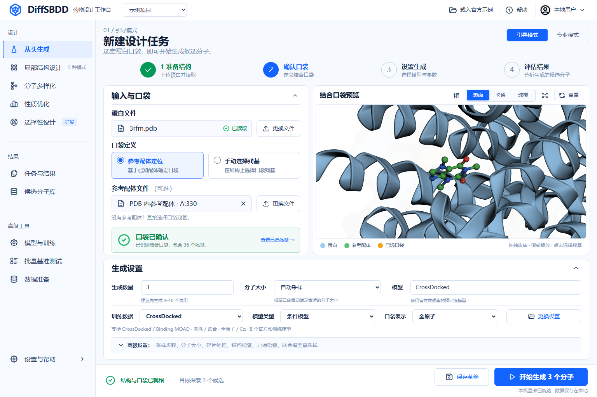

# DiffSBDD Workbench

**从蛋白口袋出发，生成、检查、编辑，再继续下一轮分子设计。**

[](LICENSE)
[](#开始使用)

面向药物化学人员的本地分子设计工作台。把 DiffSBDD 生成、二维结构编辑、三维口袋检查、相互作用分析和设计记录放在同一个工作流里，减少结构文件与独立工具之间的来回切换。

A local molecular-design workbench for the official DiffSBDD models, with a Chinese interface.

[开始使用](#开始使用) · [适用场景](#适用场景) · [研究边界](#研究边界) · [详细使用指南](docs/getting-started.md)



*项目内的公开示例截图。展示结构与相互作用信息，不代表活性或结合姿势已经验证。*

## 适用场景

| 你想做什么 | 在工作台里怎样继续 |
|---|---|
| 围绕一个结合口袋寻找新结构 | 上传蛋白，以参考配体、三维 SDF 或残基选择定义口袋，使用官方 DiffSBDD 模型生成候选 |
| 保留已有结构中的关键部分 | 在三维视图中选择整环或原子，开展片段生长、连接或骨架重建 |
| 围绕一个候选继续探索 | 进行分子多样化，或以 QED / SA 为目标做多轮性质优化 |
| 把一个想法整理成可审阅的设计 | 用 Ketcher 编辑二维结构，检查对齐后的三维构象，保存设计理由、人工评价和下一轮设置 |

## 一条连续的设计流程

1. **准备口袋**：上传 PDB 和参考结构；按需选链、去水或筛选非蛋白成分，保持原始坐标
2. **生成候选**：选择任务和模型，用快速试跑检查流程，再调整候选数量、分子大小和探索参数
3. **审阅结构**：同时查看二维结构、三维环境、连通性、化学性质和 ProLIF 相互作用提示；原始候选与拒绝原因可追溯
4. **编辑并迭代**：修改原子或键，生成并对齐新的起始构象，把保留片段或编辑版带入下一轮
5. **保存与分享结果**：保留完整设计输入和参数，导出 SDF、MOL、性质 CSV、口袋 PDB 与高分辨率 PNG

简洁模式提供常用选择；专家模式展开当前任务适用的精细参数。历史任务、保存的设计、候选分子库和任务比较帮助你回看探索过程。三维显示支持蛋白卡通、口袋表面、邻近残基、测距和透明背景出图。

## 本地运行与数据

- 推理、编辑、预览和设计记录保存在本机，不需要云端模型 API 或账户
- 首次安装需要联网下载依赖、官方代码和约 300 MB 模型权重；缓存就绪后可离线推理与编辑
- 可选的化学组分下载仅发送公开组分编号，不上传蛋白、分子坐标或设计记录
- 服务仅面向单用户 localhost；没有多人认证系统，请勿直接开放到局域网或公网

## 开始使用

需要 **Linux x86_64 / WSL2 Ubuntu、NVIDIA GPU 和兼容 CUDA 12.8 的驱动**。项目已记录的验证环境是 Windows 11 + WSL2 Ubuntu、32 GB 内存和 RTX 5060 Laptop 8 GB；这不是对所有硬件的兼容保证。

在 Ubuntu / WSL2 Ubuntu 中，先准备 Git、curl、[uv](https://docs.astral.sh/uv/getting-started/installation/)，并确认 `nvidia-smi` 能看到显卡：

```bash
git clone https://github.com/Victor-Xu-1/diffsbdd-workbench.git
cd diffsbdd-workbench
sudo install -d -o "$(id -u)" -g "$(id -g)" /opt/diffsbdd
bash install.sh
bash web.sh
```

打开 **http://127.0.0.1:7865/**，主动载入官方示例或上传自己的 PDB。`/opt/diffsbdd` 必须是本工作台的专用空目录；已有其他内容时请先选择自定义运行目录。CUDA / PyTorch 依赖另需数 GB 磁盘空间。

[完整安装、Windows 快捷启动、数据目录和故障恢复](docs/getting-started.md)

## 研究边界

- **生成结构需要审阅**：DiffSBDD 生成原子元素和三维位置，不直接生成化学键。完整片段模式会恢复并检查输入片段的已知键型，但可能显著降低有效率；多个保留片段也不保证最终连通
- **性质分数不代表活性**：QED / SA 改善不是结合活性、选择性、ADMET 或合成可行性的验证。编辑后的对齐构象也不是已验证的结合姿势
- **相互作用有明确范围**：ProLIF 采用标准氨基酸模板和隐式氢规则；不包含水桥、金属配位或共价作用。几何测距不替代质子化准备、对接、能量评价或实验
- **输入准备只做筛选**：不会重建缺失原子或分配质子化状态。人工反馈保存在设计记录中，不会自动训练模型
- **计算规模有限**：单安装一次一个任务、逐分子计算；最多 100 个候选、8–80 个重原子、1000 个口袋重原子，单任务一小时上限。训练、基准数据集管理和合成路线规划不在范围内

[完整科学范围与出图说明](docs/scientific-scope.md) · [已有验证与已知限制](docs/VALIDATION.md) · [当前已知问题](https://github.com/Victor-Xu-1/diffsbdd-workbench/issues)

## 来源与许可证

这是独立社区项目，与 DiffSBDD 原作者没有隶属关系。模型来自 [官方 DiffSBDD](https://github.com/arneschneuing/DiffSBDD)，科学依据为 [Structure-based drug design with equivariant diffusion models](https://doi.org/10.1038/s43588-024-00737-x)。

工作台自有代码使用 [MIT](LICENSE)。官方模型权重和第三方组件保留各自许可证，见[第三方来源与许可证](THIRD_PARTY_NOTICES.md)。[安全与隐私](SECURITY.md)和[贡献指南](CONTRIBUTING.md)提供进一步说明。
